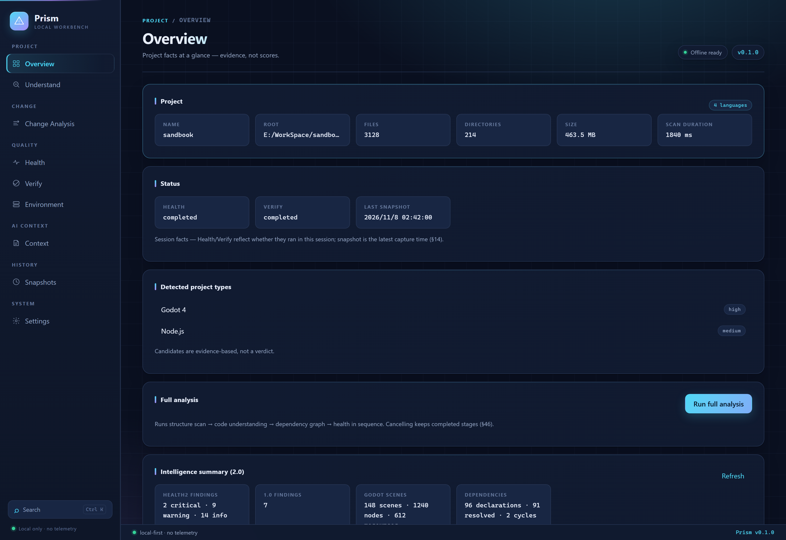

# ifuyo Prism

[](https://github.com/taozhihaoo/ifuyo-prism/actions/workflows/ci.yml)
[](LICENSE)

**English** · [简体中文](README.zh-CN.md)

> **An AI-native, local-first workbench for understanding projects and auditing engineering health.**
>
> Prism does not write your project for you. It makes you and your AI able to
> *read the project, read the changes, find the risks, verify the outcome, and
> produce trustworthy context* — and to see and deploy it.



---

## What Prism is

A local workbench that builds capability along one chain:

```text
understand → see changes → find risks → verify → generate context → observe → ship
```

### 1.0 — Engineering health check (delivered)

| Capability | What it does |
| --- | --- |
| **Understand** | Structure, symbols and dependency graph (M1–M3), git facts (M4), ChangeSet (M5) |
| **Changes → Impact** | Git diff → ChangeSet → impact analysis (M6) → health findings (M7: 13 deterministic rules, evidence-backed) |
| **Health** | Findings with evidence — deliberately no "project score" |
| **Verify** | Unified build / test / lint orchestration (M8: Node, Python, C#, Rust adapters, structured parsing, CI extraction, release checks) |
| **Environment** | Project requirements vs. machine facts (M9: requirement levels, conflicts preserved, ports/processes) |
| **Context** | Risk-weighted, task-aware AI context packs (M10: deterministic selection, context health, trust/risk — works without an LLM) |
| **Snapshot** | Persistent engineering memory (M11: stable identity, multi-domain fingerprints, SQLite, compare/timeline/history) |

### 2.0 — Intelligence layer (M20–M215, delivered)

Built on a unified engineering-fact layer (`prism-intel`: Entity / Fact / Evidence /
Relation / Finding), extended along the same chain:

- **L0/L1/L2** — structural inventory (M22) → C# symbol engine on tree-sitter (M23) → semantic relations (M25: CALLS / INHERITS / IMPLEMENTS / OVERRIDES)
- **Godot adapter** — scene / node / script / resource parsing (M24) and cross-layer linking
- **Evidence graph & impact** — unified evidence graph with reverse impact sets and evidence paths (M26)
- **Context 2.0** — impact/change-aware context packs (M27, `--impact-aware`)
- **Health 2.0** — unified findings, 19 built-in rules across 7 categories, lifecycle (New / Persistent / Resolved / Regressed / Suppressed), quality gate (M28)
- **Dependency / security / environment** — declaration vs. resolution, lockfiles, SBOM, secret detection with end-to-end redaction, offline advisory matching (M29)
- **Debug intelligence** — logs → events → error fingerprints → clusters → stack frames → symbol/scene links (M210)
- **Git evolution** — file/symbol history, hotspots, change coupling (M211)
- **Visualization** — godot / architecture / dependency / impact projections (M212), deterministic and bounded view models
- **API & webhook debugging** — endpoint discovery (ASP.NET / Express / FastAPI), bounded HTTP observation with an SSRF guard, local webhook receiver with HMAC signing, correlation chains (M213)
- **Developer deploy** — artifact identity and manifests, atomic local activation, preflight/policy/plan/execute separation, rollback/history/diff (M214)

## What Prism is not

- Not an IDE, code editor, or AI coding agent
- Not a Git GUI, linter dashboard, or dependency viewer
- Not a ChatGPT clone, not a hosted LLM, not a cloud service, not a DevOps/CI platform
- Not a tool that auto-commits or mass-edits your code
- Not an API gateway, packet sniffer, or pentest tool (M213 only observes an explicitly probed surface)
- Not a remote shell (M214 is a controlled deployment system)

The full boundary is defined in `Spec/` (the project charter, §19 "explicitly out of scope").

## Screenshots

The desktop app, dark theme, English UI. The Chinese UI is shown in
[README.zh-CN.md](README.zh-CN.md).


## Architecture

```text
ifuyo-prism/
├─ crates/
│  ├─ prism-core/         # foundation: IDs, errors, config, tasks, logging, runtime
│  ├─ prism-project/      # discovery: scan, ignore, languages, classification, entry points
│  ├─ prism-parser/       # symbols + tree-sitter adapters
│  ├─ prism-analysis/     # code model / symbol index orchestration
│  ├─ prism-graph/        # modules, resolution, dependency graph, cycles, metrics
│  ├─ prism-git/          # git facts + evolution
│  ├─ prism-changes/      # ChangeSet: git diff × code model
│  ├─ prism-impact/       # 1.0 impact layer
│  ├─ prism-health/       # 1.0 health layer (13 rules)
│  ├─ prism-verify/       # verification orchestration
│  ├─ prism-env/          # environment facts
│  ├─ prism-context/      # context packs
│  ├─ prism-snapshot/     # snapshots, compare, timeline
│  ├─ prism-store/        # SQLite persistence
│  ├─ prism-intel/        # 2.0 core: Entity/Fact/Evidence/Relation/Finding + impact
│  ├─ prism-l0/           # 2.0 structural analysis
│  ├─ prism-csharp/       # 2.0 C# symbols, semantics, change mapping
│  ├─ prism-godot/        # 2.0 Godot adapter
│  ├─ prism-health2/      # 2.0 unified findings, lifecycle, gate
│  ├─ prism-supply/       # dependency / security / SBOM / environment
│  ├─ prism-debug/        # logs, error fingerprints, clusters, stack frames
│  ├─ prism-evolution/    # evolution facts, hotspots, coupling
│  ├─ prism-viz/          # visualization projections
│  ├─ prism-api/          # API / webhook debugging
│  ├─ prism-deploy/       # controlled deployment
│  └─ prism-cli/          # the `prism` command
├─ src-tauri/             # Tauri 2 shell — IPC boundary only, no business logic
├─ src/                   # React frontend (app / components / pages / services / types)
├─ tests/                 # cross-crate integration tests + fixtures
├─ docs/                  # architecture contracts, audits, roadmap
├─ Spec/                  # project charter and per-milestone specifications
└─ scripts/               # build & fixture helpers
```

**Design invariants**

- **GUI and CLI share one core.** Business logic exists once; Tauri and the CLI are thin shells.
- **Projections are not facts.** Visualization, deploy and observation are projections of the intelligence core — there is no second source of truth.
- **Unknown ≠ false.** Missing data, parse failures and unavailable credentials are reported as such, never rendered as zero or "all good".
- **Deterministic first.** Core analysis is deterministic code; AI is an optional enhancement layer.

## Tech stack

| Layer | Technology |
| --- | --- |
| Desktop shell | Tauri 2 |
| Core | Rust (Cargo workspace, 26 `prism-*` crates) |
| Frontend | React 18 + TypeScript + Vite |
| CLI | Rust (`prism`, shares the core with the GUI) |
| Parsing | tree-sitter (incremental C# and other grammars) |
| Hashing | SHA-256 (artifact / manifest identity) |
| Storage | SQLite (via `rusqlite`, bundled) |

## Getting started

### Prerequisites

- Rust 1.85+ (edition 2021)
- Node.js 18+
- Tauri 2 platform dependencies ([system packages for your OS](https://v2.tauri.app/start/prerequisites/))

### Develop

```bash
npm install
npm run tauri dev        # desktop app with HMR
```

To preview the UI in a browser without building the Rust side, use the bundled
demo entry (deterministic sample data, no IPC required):

```bash
npm run dev
# http://localhost:5173/demo.html?lang=en
# http://localhost:5173/demo.html?lang=zh
```

### Build

```bash
npm run tauri build      # desktop bundle (Windows: NSIS installer + standalone exe)
npm run build            # frontend only (dist/)
cargo build --release    # Rust CLI (`prism`)
```

## CLI

```bash
# ---- 1.0 engineering health ----
prism scan <path>                  # project discovery
prism inspect <path>               # symbols
prism graph <path>                 # dependency & architecture graph
prism git status|log|diff <path>   # git facts (read-only)
prism changes <path>               # ChangeSet
prism impact <path>                # impact analysis
prism health <path>                # health findings (1.0 rules)
prism verify <path>                # verification orchestration
prism env <path>                   # environment facts
prism context <path> --task "..."  # AI context pack
prism snapshot|history|compare|timeline <path>

# ---- 2.0 intelligence ----
prism intel <path> --domain dependency|structural|symbols|semantic|godot|impact
prism health2 <path> [--baseline f.json]
prism supply <path> [--advisories db.json] [--policy p.json] [--sbom out.json]
prism debug <path> [--source f.log]
prism git evolution|hotspots|coupling|symbol-history|blame|commit-impact <file>
prism viz --view architecture|godot|dependency
prism api endpoints|observe|correlate|webhook-listen
prism deploy artifact|plan|run|history|rollback
```

Every command supports `--json` with a stable schema and `--help`.

## MCP server

```bash
prism mcp   # read-only JSON-RPC stdio server (newline-delimited)
```

Lets local AI clients (Claude Desktop, Claude Code, …) consume Prism's **persisted**
analysis results from the same SQLite store the GUI uses (`analysis_runs`,
`PRISM_DB_PATH`). Tools: `list_projects`, `list_runs`, `get_report`, `get_finding`
(with evidence expansion). It does not re-run analysis, does not read project files,
and does not write data; stdout carries protocol only, logs go to stderr.

```json
{
  "mcpServers": {
    "prism": {
      "command": "/path/to/prism",
      "args": ["mcp"]
    }
  }
}
```

## Data and privacy

- **No telemetry, no automatic upload.** Analysis runs entirely on your machine.
- **The project is only read.** Prism does not modify your working tree; it does not
  auto-commit. Snapshots are engineering-state records, not source backups.
- **State lives outside the project.** The snapshot database is stored in the OS
  application-data directory (`PRISM_DB_PATH` overrides it).
- **Network is opt-in and bounded.** Only API observation and deploy reach the
  network, only on explicit intent, and only through an SSRF guard / allowlist.
- **Secrets are redacted** at every stage: detection → findings → context packs → logs.

See [SECURITY.md](SECURITY.md) for the full security model and how to report a
vulnerability.

## Testing

```bash
cargo test --workspace                  # Rust unit + integration tests
npm run typecheck                       # frontend type check
npm test                                # 96 frontend component tests (vitest)
cargo clippy --workspace --all-targets  # lints
```

## Documentation

- [docs/architecture.md](docs/architecture.md) — architecture overview
- [docs/development.md](docs/development.md) — development guide
- `docs/architecture/PRISM_2_0_*.md` — per-milestone contracts
- [docs/audits/2.0-M215-final-audit.md](docs/audits/2.0-M215-final-audit.md) — final 2.0 audit
- [docs/health-rules.md](docs/health-rules.md) — 1.0 health rules
- `Spec/` — project charter and milestone specifications

## License

Dual-licensed under either of

- Apache License, Version 2.0 ([LICENSE-APACHE](LICENSE-APACHE))
- MIT License ([LICENSE-MIT](LICENSE-MIT))

at your option. `SPDX-License-Identifier: MIT OR Apache-2.0`

Unless you explicitly state otherwise, any contribution intentionally submitted for
inclusion in this project shall be dual-licensed as above, without any additional
terms or conditions.
