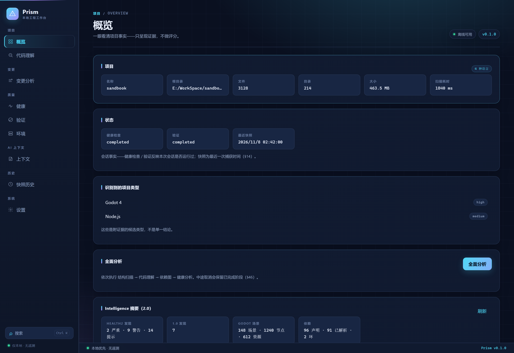

# ifuyo Prism

[](https://github.com/taozhihaoo/ifuyo-prism/actions/workflows/ci.yml)
[](LICENSE)

[English](README.md) · **简体中文**

> **AI-native、local-first 的项目理解与工程体检工作台。**
>
> Prism 不替你写项目，而负责让你和 AI **看懂项目、看懂变化、找到风险、
> 验证结果、生成可靠上下文**——并看见、部署它。



---

## Prism 是什么

一个理解软件项目的本地工作台，沿这条链路构建能力：

```text
看懂项目 → 看懂变化 → 发现风险 → 验证项目 → 生成上下文 → 观察运行 → 看见/部署
```

### 1.0 — 工程体检（已交付）

| 能力 | 说明 |
| --- | --- |
| **Understand** | 结构 / 符号 / 依赖图（M1–M3）+ Git 事实（M4）+ ChangeSet（M5） |
| **Changes → Impact** | Git 变化 → ChangeSet → 影响分析（M6）→ 健康发现（M7：13 条确定性规则，全部附证据） |
| **Health** | 基于 Evidence 的 Finding 体系——**不做"项目评分"** |
| **Verify** | 构建 / 测试 / lint 统一编排（M8：Node、Python、C#、Rust 适配 + 结构化解析 + CI 静态抽取 + Release 检查） |
| **Environment** | 项目要求 vs. 机器事实（M9：requirement 层级、冲突保留、端口 / 进程动态事实） |
| **Context** | 风险加权、任务感知的 AI 上下文包（M10：确定性选择 + Context Health + trust/risk，无 LLM 也能工作） |
| **Snapshot** | 工程事实的持久化记忆（M11：稳定身份 + 多域指纹 + SQLite + compare / timeline / history） |

### 2.0 — Intelligence（M20–M215，已交付）

在统一的工程事实层（`prism-intel`：Entity / Fact / Evidence / Relation / Finding）
之上，沿同一条链扩展：

- **L0 / L1 / L2** — 结构清单（M22）→ 基于 tree-sitter 的 C# 符号引擎（M23）→ 语义关系解析（M25：CALLS / INHERITS / IMPLEMENTS / OVERRIDES）
- **Godot Adapter** — Scene / Node / Script / Resource 解析（M24）与跨层关联
- **Evidence Graph & Impact** — 统一证据图 + 反向影响集合 + 证据路径（M26）
- **Context 2.0** — 影响 / 变更感知的上下文包（M27，`--impact-aware`）
- **Health 2.0** — 统一 Finding 模型 + 19 条内建规则（7 categories）+ 生命周期（New / Persistent / Resolved / Regressed / Suppressed）+ Quality Gate（M28）
- **依赖 / 安全 / 环境** — 声明与解析分离 + lockfile + SBOM + secret 检测（全链 redaction）+ 离线 advisory 匹配（M29）
- **Debug Intelligence** — 日志 → 事件 → 错误指纹 → 聚类 → 栈帧 → 符号 / 场景关联（M210）
- **Git Evolution** — 文件 / 符号历史回放 + 热点 + 变更耦合（M211）
- **Visualization** — godot 跨层 / architecture 层级 / dependency / impact 四类投影（M212），确定性有界 View Model
- **API / Webhook 调试** — 端点发现（ASP.NET / Express / FastAPI）+ 有界 HTTP 观测（SSRF guard）+ 本地 Webhook 接收器（HMAC 签名）+ 关联链（M213）
- **Developer Deploy** — Artifact 身份 / Manifest + 原子 activate + Preflight / Policy / Plan / Execute 分离 + Rollback / History / Diff（M214）

## Prism 不是什么

- 不是 IDE / 代码编辑器 / AI Coding Agent
- 不是 Git GUI / Linter Dashboard / 依赖查看器
- 不是 ChatGPT 复刻、不自研 LLM、不是云服务、不是 DevOps / CI 平台
- 不会自动提交，也不会大规模改你的代码
- 不是 API 网关 / 抓包工具 / 渗透测试工具（M213 只观测显式指定的面）
- 不是远程 Shell（M214 是受控部署系统）

完整边界见 `Spec/` 中的开发总纲领（§19 明确不做）。

## 界面截图

桌面端、深色主题、中文界面。英文界面见 [README.md](README.md)。


## 架构

```text
ifuyo-prism/
├─ crates/
│  ├─ prism-core/         # 地基：ID / 错误 / 配置 / 任务 / 日志 / 运行时抽象
│  ├─ prism-project/      # 项目发现：扫描 / ignore / 语言 / 分类 / 入口点
│  ├─ prism-parser/       # Symbol 模型 + tree-sitter adapters
│  ├─ prism-analysis/     # CodeModel / SymbolIndex 编排
│  ├─ prism-graph/        # 模块 / 解析 / 依赖图 / 环 / 指标
│  ├─ prism-git/          # Git facts + 演化事实
│  ├─ prism-changes/      # ChangeSet：Git diff × 代码模型
│  ├─ prism-impact/       # 1.0 影响层
│  ├─ prism-health/       # 1.0 健康层（13 条规则）
│  ├─ prism-verify/       # 验证编排
│  ├─ prism-env/          # 环境事实
│  ├─ prism-context/      # Context Pack
│  ├─ prism-snapshot/     # 快照 / 对比 / 时间线
│  ├─ prism-store/        # SQLite 持久化
│  ├─ prism-intel/        # 2.0 统一核心：Entity/Fact/Evidence/Relation/Finding + Impact
│  ├─ prism-l0/           # 2.0 结构分析
│  ├─ prism-csharp/       # 2.0 C# 符号 / 语义 / 变更映射
│  ├─ prism-godot/        # 2.0 Godot Adapter
│  ├─ prism-health2/      # 2.0 统一 Finding / 生命周期 / Gate
│  ├─ prism-supply/       # 依赖 / 安全 / SBOM / 环境
│  ├─ prism-debug/        # 日志 / 错误指纹 / 聚类 / 栈帧
│  ├─ prism-evolution/    # 演化事实 / 热点 / 耦合
│  ├─ prism-viz/          # 可视化投影
│  ├─ prism-api/          # API / Webhook 调试
│  ├─ prism-deploy/       # 受控部署
│  └─ prism-cli/          # `prism` 命令行
├─ src-tauri/             # Tauri 2 应用壳——只有 IPC 边界，无业务逻辑
├─ src/                   # React 前端（app / components / pages / services / types）
├─ tests/                 # 跨 crate 集成测试 + fixtures
├─ docs/                  # 架构契约 / 审计报告 / roadmap
├─ Spec/                  # 开发总纲领与各里程碑规格
└─ scripts/               # 构建与 fixture 辅助脚本
```

**设计不变量**

- **GUI / CLI 共享 Core**：业务逻辑只有一份，Tauri 与 CLI 都是薄壳
- **投影非事实**：可视化 / 部署 / 观测都是 Intelligence Core 的投影，不建第二事实源
- **Unknown ≠ False**：数据缺失、解析失败、凭证不可用全部如实标注，不伪装成零或正常
- **Deterministic First**：核心分析是确定性代码，AI 只是可选增强层

## 技术栈

| 层 | 技术 |
| --- | --- |
| Desktop 壳 | Tauri 2 |
| Core | Rust（Cargo workspace，26 个 `prism-*` crate） |
| 前端 | React 18 + TypeScript + Vite |
| CLI | Rust（`prism`，与 GUI 共享 Core） |
| 解析 | tree-sitter（C# 等增量语法解析） |
| 哈希 | SHA-256（Artifact / Manifest 身份） |
| 存储 | SQLite（`rusqlite`，bundled） |

## 快速开始

### 环境要求

- Rust 1.85+（edition 2021）
- Node.js 18+
- Tauri 2 平台依赖（[各系统安装包](https://v2.tauri.app/start/prerequisites/)）

### 开发

```bash
npm install
npm run tauri dev        # 桌面端（带 HMR）
```

只想在浏览器里看界面、不编译 Rust 时，可以用内置的演示入口
（固定演示数据，不需要 IPC）：

```bash
npm run dev
# http://localhost:5173/demo.html?lang=en
# http://localhost:5173/demo.html?lang=zh
```

### 构建

```bash
npm run tauri build      # 桌面安装包（Windows：NSIS 安装器 + 独立 exe）
npm run build            # 仅前端产物（dist/）
cargo build --release    # Rust CLI（`prism`）
```

## CLI

```bash
# ---- 1.0 工程体检 ----
prism scan <path>                  # 项目发现
prism inspect <path>               # 代码符号
prism graph <path>                 # 依赖与架构图
prism git status|log|diff <path>   # Git facts（只读）
prism changes <path>               # ChangeSet
prism impact <path>                # 影响分析
prism health <path>                # 健康体检（1.0 规则）
prism verify <path>                # 验证编排
prism env <path>                   # 环境事实
prism context <path> --task "..."  # AI 上下文包
prism snapshot|history|compare|timeline <path>

# ---- 2.0 Intelligence ----
prism intel <path> --domain dependency|structural|symbols|semantic|godot|impact
prism health2 <path> [--baseline f.json]
prism supply <path> [--advisories db.json] [--policy p.json] [--sbom out.json]
prism debug <path> [--source f.log]
prism git evolution|hotspots|coupling|symbol-history|blame|commit-impact <file>
prism viz --view architecture|godot|dependency
prism api endpoints|observe|correlate|webhook-listen
prism deploy artifact|plan|run|history|rollback
```

全部命令支持 `--json`（稳定 schema）与 `--help`。

## MCP server

```bash
prism mcp   # 只读 JSON-RPC stdio 服务器（newline-delimited）
```

让本地 AI 客户端（Claude Desktop、Claude Code 等）直接消费 Prism 的**持久化**
分析结果——与 GUI 共用同一份 SQLite（`analysis_runs`，`PRISM_DB_PATH` 同口径）。
工具：`list_projects` / `list_runs` / `get_report` / `get_finding`（含证据展开）。
它不重跑分析、不读项目文件、不写任何数据；stdout 只承载协议，日志走 stderr。

```json
{
  "mcpServers": {
    "prism": {
      "command": "/path/to/prism",
      "args": ["mcp"]
    }
  }
}
```

## 数据与隐私

- **无遥测、无自动上传**：分析全部在本机完成
- **只读项目**：不修改工作区、不自动提交；快照是工程状态记录，不是源码备份
- **状态不落在项目里**：快照数据库位于系统 AppData（可用 `PRISM_DB_PATH` 覆盖）
- **网络是按需且有界的**：只有 API 观测与部署会联网，且必须由用户显式触发，
  并经过 SSRF guard / allowlist
- **Secret 全链 redaction**：检测 → finding → 上下文包 → 日志

安全模型与漏洞上报方式见 [SECURITY.md](SECURITY.md)。

## 测试

```bash
cargo test --workspace                  # Rust 单元 + 集成测试
npm run typecheck                       # 前端类型检查
npm test                                # 96 项前端组件测试（vitest）
cargo clippy --workspace --all-targets  # lint
```

## 文档

- [docs/architecture.md](docs/architecture.md) — 架构总览
- [docs/development.md](docs/development.md) — 开发指南
- `docs/architecture/PRISM_2_0_*.md` — 各里程碑契约
- [docs/audits/2.0-M215-final-audit.md](docs/audits/2.0-M215-final-audit.md) — 2.0 最终审计
- [docs/health-rules.md](docs/health-rules.md) — 1.0 健康规则
- `Spec/` — 开发总纲领与里程碑规格

## 许可证

采用双许可，你可任选其一：

- Apache License 2.0（[LICENSE-APACHE](LICENSE-APACHE)）
- MIT License（[LICENSE-MIT](LICENSE-MIT)）

`SPDX-License-Identifier: MIT OR Apache-2.0`

除你另有明确声明外，任何有意提交以纳入本项目的贡献，均按上述双许可授权，
不附加任何额外条款或条件。
